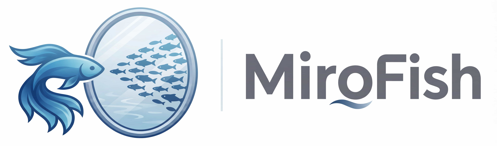
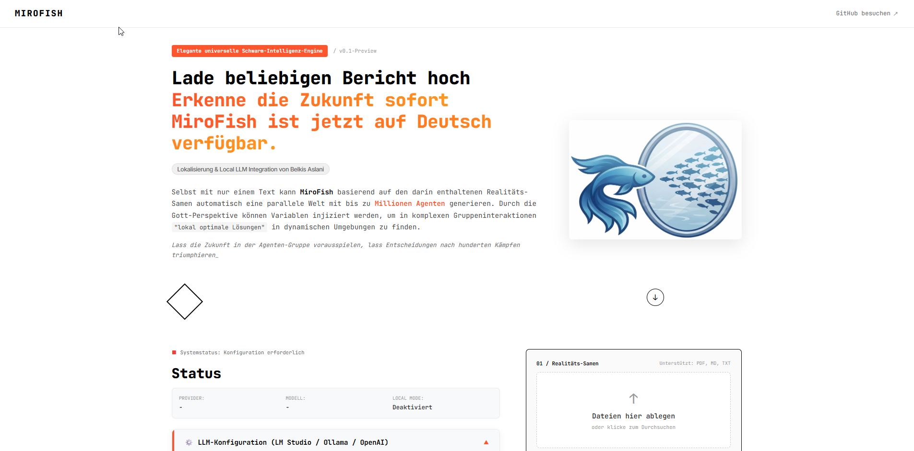
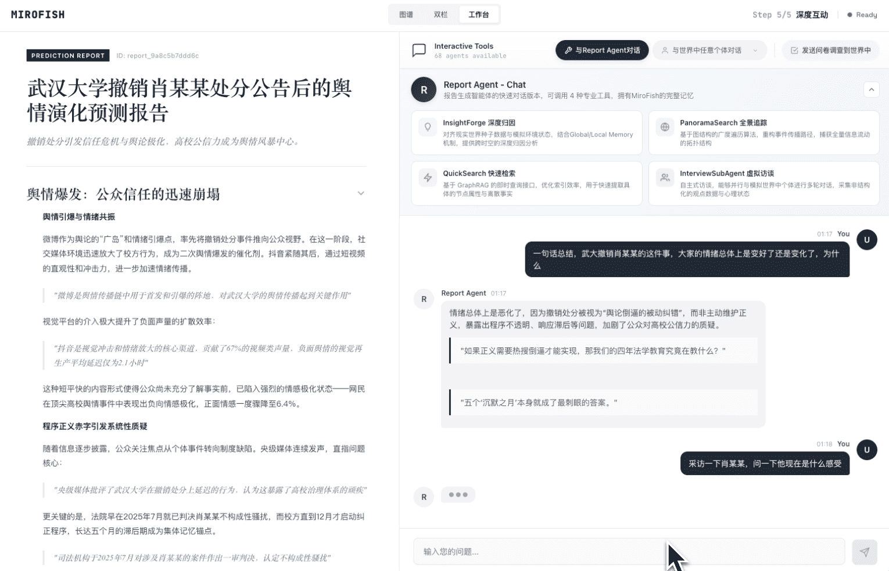
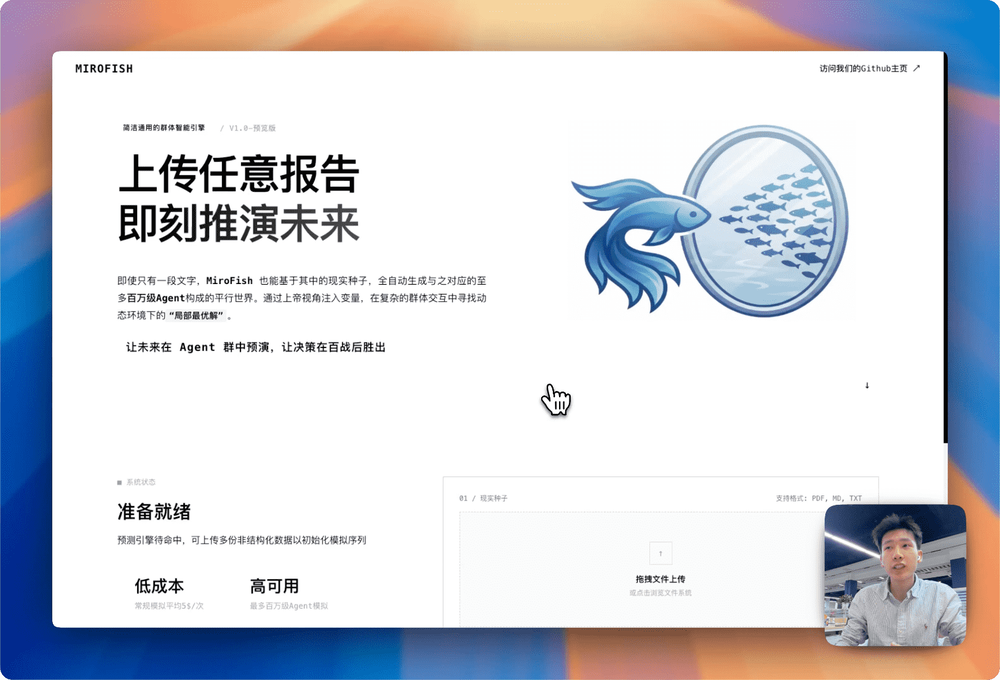
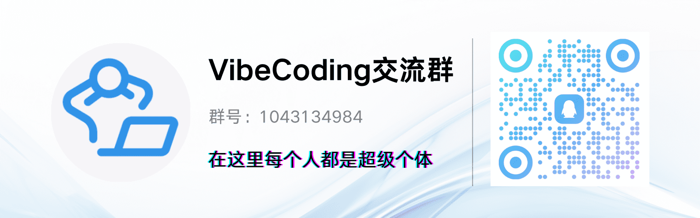

<div align="center">



<a href="https://trendshift.io/repositories/16144" target="_blank"></a>

Simple and versatile swarm intelligence engine, predicting everything
</br>
<em>A Simple and Universal Swarm Intelligence Engine, Predicting Anything</em>

## 🚀 New in this edition (October 2026)

*   **One click to the report:** upload documents, ask a question – MiroFish runs every step on its own and shows progress live.
*   **Fully local:** Ollama models instead of a cloud API, agent memory as Markdown (Obsidian-compatible), no Zep account needed.
*   **Models detected automatically:** Settings list every installed model to choose from.
*   **New interface:** for phone and desktop, German and English, freely selectable colour pairs.
*   **History with export and delete**, HTTP interface for scripts and AI agents ([docs/API.md](docs/API.md)).
*   **How reliable is it?** Plain-language explanation: [docs/RELIABILITY.md](docs/RELIABILITY.md).

---

<a href="https://www.shanda.com/" target="_blank"></a>

[](https://github.com/666ghj/MiroFish/stargazers)
[](https://github.com/666ghj/MiroFish/watchers)
[](https://github.com/666ghj/MiroFish/network)
[](https://hub.docker.com/)
[](https://deepwiki.com/666ghj/MiroFish)

[](https://discord.com/channels/1469200078932545606/1469201282077163739)
[](https://x.com/mirofish_ai)
[](https://www.instagram.com/mirofish_ai/)

[English](./README-EN.md) | [Deutsch](./README.md)

</div>

## ⚡ Overview

**MiroFish** is a next-generation AI prediction engine powered by multi-agent technology. By extracting seed information from the real world (such as breaking news, policy drafts, or financial signals), it automatically constructs a high-fidelity parallel digital world. Within this space, thousands of intelligent agents with independent personalities, long-term memory, and behavioral logic freely interact and undergo social evolution. You can inject variables dynamically from a "God's-eye view" to precisely deduce future trajectories — **rehearse the future in a digital sandbox, and win decisions after countless simulations**.

> You only need to: Upload seed materials (data analysis reports or interesting novel stories) and describe your prediction requirements in natural language</br>
> MiroFish will return: A detailed prediction report and a deeply interactive high-fidelity digital world

### Our Vision

MiroFish is dedicated to creating a swarm intelligence mirror that maps reality. By capturing the collective emergence triggered by individual interactions, we break through the limitations of traditional prediction:

- **At the Macro Level**: We are a rehearsal laboratory for decision-makers, allowing policies and public relations to be tested at zero risk
- **At the Micro Level**: We are a creative sandbox for individual users — whether deducing novel endings or exploring imaginative scenarios, everything can be fun, playful, and accessible

From serious predictions to playful simulations, we let every "what if" see its outcome, making it possible to predict anything.

## 🌐 Live Demo

Welcome to visit our online demo environment and experience a prediction simulation on trending public opinion events we've prepared for you: [mirofish-live-demo](https://666ghj.github.io/mirofish-demo/)

## 📸 Screenshots

<div align="center">
<table>
<tr>
<td></td>
<td></td>
</tr>
<tr>
<td></td>
<td></td>
</tr>
<tr>
<td></td>
<td></td>
</tr>
</table>
</div>

## 🎬 Demo Videos

### 1. Wuhan University Public Opinion Simulation + MiroFish Project Introduction

<div align="center">
<a href="https://www.bilibili.com/video/BV1VYBsBHEMY/" target="_blank"></a>

Click the image to watch the complete demo video for prediction using BettaFish-generated "Wuhan University Public Opinion Report"
</div>

### 2. Dream of the Red Chamber Lost Ending Simulation

<div align="center">
<a href="https://www.bilibili.com/video/BV1cPk3BBExq" target="_blank"></a>

Click the image to watch MiroFish's deep prediction of the lost ending based on hundreds of thousands of words from the first 80 chapters of "Dream of the Red Chamber"
</div>

> **Financial Prediction**, **Political News Prediction** and more examples coming soon...

## 🔄 Workflow

1. **Graph Building**: Seed extraction & Individual/collective memory injection & GraphRAG construction
2. **Environment Setup**: Entity relationship extraction & Persona generation & Agent configuration injection
3. **Simulation**: Dual-platform parallel simulation & Auto-parse prediction requirements & Dynamic temporal memory updates
4. **Report Generation**: ReportAgent with rich toolset for deep interaction with post-simulation environment
5. **Deep Interaction**: Chat with any agent in the simulated world & Interact with ReportAgent

## 🚀 Quick Start

MiroFish runs entirely on your computer: a local language model via [Ollama](https://ollama.com) and the agents'
memory as Markdown files. No account, no cloud costs. A graphics card with 8 GB is enough.

### 1. Ollama and models

```bash
# Install Ollama: https://ollama.com/download
ollama pull gemma4:12b-it-qat     # main model: reads documents, writes the report
ollama pull gemma4:e4b-it-qat     # agent model: faster, speaks for the agents
```

Ollama picks its context length from GPU memory; below 24 GB that is only 4096 tokens – too little for the ontology
and the report. Set the server to 16,384:

```bash
# Linux (systemd):
sudo systemctl edit ollama   # add:  [Service]  Environment="OLLAMA_CONTEXT_LENGTH=16384"
sudo systemctl restart ollama
# macOS / Windows: set the environment variable OLLAMA_CONTEXT_LENGTH=16384 and restart Ollama
```

Other models work the same way; MiroFish lists every installed model under **Settings**.

### 2a. Run with Docker (recommended)

```bash
git clone https://github.com/BEKO2210/MiroFish-DE.git && cd MiroFish-DE
# If needed, first copy .env.example to .env and adjust the models or API_TOKEN.
# localhost/127.0.0.1 is changed to host.docker.internal automatically on the first Docker start.
sh scripts/start.sh
```

`scripts/start.sh` creates a missing `.env` and `data/` as your user (otherwise Docker creates a directory `./.env`
or a root-owned `data/`) and then runs `docker compose up -d --build`. Without the script, first run
`[ -f .env ] || cp .env.example .env; mkdir -p data` and set `MIROFISH_UID`/`MIROFISH_GID`.

Open **http://localhost:5001**. On first start MiroFish copies the settings from `.env` to `data/.env`, where
subsequent setting changes persist. **Later edits to `./.env` are not picked up** – only `data/.env` (or the
Settings page) applies afterwards; run `docker compose restart` after editing it. The container ignores
`FLASK_PORT`/`FLASK_HOST` from `.env` (internal port 5001, external via `MIROFISH_PORT`). Uploads, simulations and reports also live in `data/`. Before starting, set
`MIROFISH_PORT` in `.env` to use another local port. The container runs with your UID/GID (`scripts/start.sh` detects them via `id -u`/`id -g`; macOS: 501);
override them in `.env` as `MIROFISH_UID`/`MIROFISH_GID` if needed. Docker Desktop (macOS/Windows) maps bind-mount
permissions to your user anyway, so the UID does not matter there. The container reaches Ollama on the host via `host.docker.internal` – on Linux Ollama must
listen only on the Docker bridge, not on the whole LAN (Ollama has no authentication): `systemctl edit ollama` →
`Environment="OLLAMA_HOST=172.17.0.1:11434"` (default bridge; check with `ip -4 addr show docker0`), then
`systemctl restart ollama` (the host `ollama` CLI then needs `OLLAMA_HOST=172.17.0.1:11434`). Use `0.0.0.0` only with a firewall rule blocking port 11434 for other devices.
Docker Desktop (macOS/Windows) needs no change.

### 2b. Run from source

Requirements: Python 3.11 (required by OASIS), Node.js 18+, [uv](https://docs.astral.sh/uv/).

```bash
git clone https://github.com/BEKO2210/MiroFish-DE.git && cd MiroFish-DE
cp .env.example .env
cd frontend && npm ci && npx vite build && cd ..
cd backend && uv sync --frozen && uv run python run.py
```

Open **http://localhost:5001**. The backend serves the built interface itself (one port).
For development with hot reload: `npm run dev` in the project root (interface on port 3000).

### Using it

1. **Home**: upload documents (PDF, Markdown, text), ask a question, press “Start forecast”.
2. The run shows every step live: reading documents → knowledge graph → agents → simulation → report.
   You can close the page; **History** has everything, with export (ZIP) and delete.
3. To control every step yourself, switch off “Run through to the report”.

Duration on an RTX 3070 with the models above: a little over 30 minutes for a short document and one simulated
week, longer for extensive material.

### Access from other devices and for agents

The app has no login and therefore only listens on `localhost`. For your phone or other computers use a protected
route such as [Tailscale](https://tailscale.com) (`tailscale serve 5001`). You can also set an `API_TOKEN` in `.env` (before the first Docker start) or in `data/.env` (afterwards, then `docker compose restart`).
The HTTP interface for your own scripts and AI agents is described in [docs/API.md](docs/API.md) – one call runs a
complete forecast up to the report.

### Cloud models

Any OpenAI-compatible service works instead of Ollama: choose provider “OpenAI” under **Settings** and enter the
address and key. Zep Cloud is optional for memory (`MEMORY_PROVIDER=zep`).

## 📬 Join the Conversation

<div align="center">

</div>

&nbsp;

The MiroFish team is recruiting full-time/internship positions. If you're interested in multi-agent simulation and LLM applications, feel free to send your resume to: **mirofish@shanda.com**

## 📄 Acknowledgments

**MiroFish has received strategic support and incubation from Shanda Group!**

MiroFish's simulation engine is powered by **[OASIS (Open Agent Social Interaction Simulations)](https://github.com/camel-ai/oasis)**, We sincerely thank the CAMEL-AI team for their open-source contributions!

## 📈 Project Statistics

<a href="https://www.star-history.com/#666ghj/MiroFish&type=date&legend=top-left">
 <picture>
   <source media="(prefers-color-scheme: dark)" srcset="https://api.star-history.com/svg?repos=666ghj/MiroFish&type=date&theme=dark&legend=top-left" />
   <source media="(prefers-color-scheme: light)" srcset="https://api.star-history.com/svg?repos=666ghj/MiroFish&type=date&legend=top-left" />
   
 </picture>
</a>
