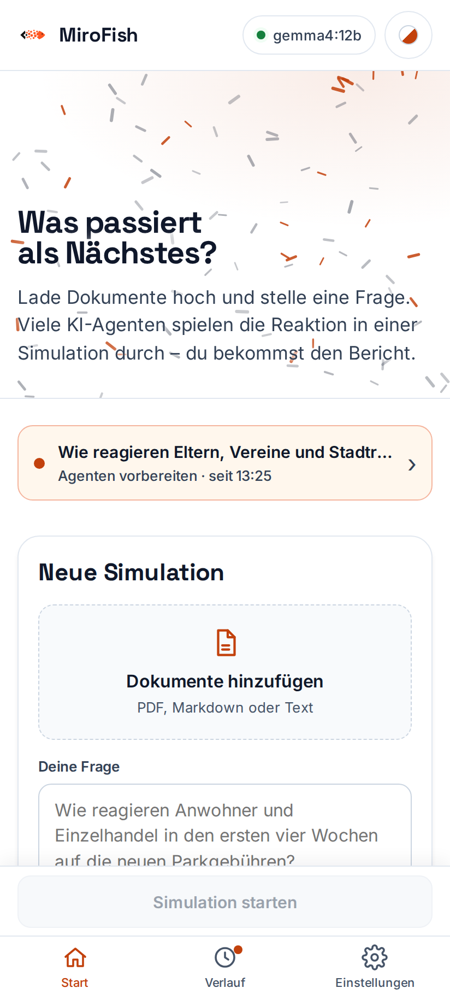
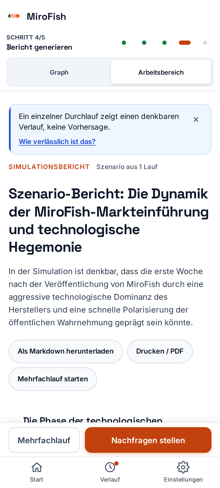
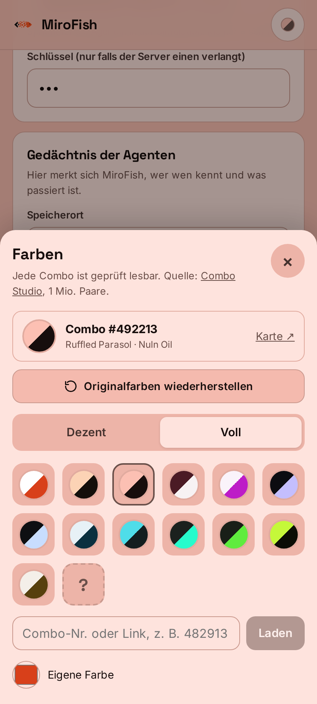

<div align="center">


<a href="https://trendshift.io/repositories/16144" target="_blank"></a>

Elegante universelle Schwarm-Intelligenz-Engine – Alles vorhersagen
</br>
<em>A Simple and Universal Swarm Intelligence Engine, Predicting Anything</em>

## 🚀 Neu in dieser Fassung (Oktober 2026)

*   **Ein Klick bis zum Bericht:** Dokumente hochladen, Frage stellen – MiroFish erledigt alle Schritte allein und zeigt den Fortschritt live.
*   **Komplett lokal:** Ollama-Modelle statt Cloud-API, Agenten-Gedächtnis als Markdown (Obsidian-kompatibel), kein Zep-Konto nötig.
*   **Modelle automatisch erkannt:** Die Einstellungen listen alle installierten Modelle zur Auswahl.
*   **Neue Oberfläche:** für Handy und Desktop, Deutsch und Englisch, frei wählbare Farb-Combos.
*   **Verlauf mit Export und Löschen**, HTTP-Schnittstelle für Skripte und KI-Agenten ([docs/API.md](docs/API.md)).
*   **Wie verlässlich ist das?** Ehrliche Erklärung für Nicht-Fachleute: [docs/VERLAESSLICHKEIT.md](docs/VERLAESSLICHKEIT.md).

---

[](https://github.com/BEKO2210/MiroFish-DE/stargazers)
[](https://github.com/BEKO2210/MiroFish-DE/watchers)
[](https://github.com/BEKO2210/MiroFish-DE/network)
[](https://hub.docker.com/)

[English](./README-EN.md) | [Deutsch](./README.md)

</div>

## ⚡ Projektübersicht

**MiroFish** ist eine neue Generation von KI-Vorhersage-Engines basierend auf Multi-Agent-Technologie. Durch die Extraktion von Realwelt-Daten (wie Breaking News, Richtlinienentwürfe, Finanzsignale) wird automatisch eine detailgetreue parallele digitale Welt erstellt. In diesem Raum interagieren und entwickeln sich Tausende von Agenten mit unabhängigen Persönlichkeiten, Langzeitgedächtnis und Verhaltenslogik frei. Über die "Gott-Perspektive" können dynamisch Variablen injiziert werden, um zukünftige Entwicklungen präzise zu antizipieren – **Lass die Zukunft im digitalen Sandkasten vorausspielen, lass Entscheidungen nach hunderten Simulationen triumphieren**.

> Du musst nur: Ausgangsmaterial hochladen (Datenanalyseberichte oder interessante Geschichten) und den Vorhersagebedarf in natürlicher Sprache beschreiben</br>
> MiroFish liefert: Einen detaillierten Vorhersagebericht sowie eine interaktive, realitätsnahe digitale Welt

### Unsere Vision

MiroFish strebt danach, einen Spiegel der Schwarm-Intelligenz zu schaffen, der die Realität abbildet. Durch die Erfassung des kollektiven Emergenz-Verhaltens, das durch individuelle Interaktionen entsteht, überwinden wir die Grenzen traditioneller Vorhersagen:

- **Makro**: Wir sind das Labor für Entscheidungsträger, wo Politik und PR risikofrei getestet werden können
- **Mikro**: Wir sind der kreative Sandkasten für individuelle Nutzer, sei es zur Vorhersage von Roman-Enden oder zum Erkunden von Ideen – alles ist interessant, unterhaltsam und greifbar

Von seriöser Vorhersage bis hin zu unterhaltsamer Simulation – wir machen jedes "Was wäre wenn" sichtbar und ermöglichen die Vorhersage von allem.

## 🌐 Live-Demo

Besuche die Online-Demo-Umgebung und erlebe eine Simulation zu einem aktuellen öffentlichen Thema: [mirofish-live-demo](https://666ghj.github.io/mirofish-demo/)

## 📸 Screenshots

<div align="center">
<table>
<tr>
<td width="20%"></td>
<td width="20%"></td>
<td width="20%"></td>
<td width="20%"></td>
<td width="20%"></td>
</tr>
<tr>
<td align="center"><sub>Startseite</sub></td>
<td align="center"><sub>Verlauf früherer Läufe</sub></td>
<td align="center"><sub>Bericht eines Einzellaufs mit Hinweis</sub></td>
<td align="center"><sub>Einstellungen mit Farb-Combos</sub></td>
<td align="center"><sub>Leitfaden „Wie verlässlich ist das?“</sub></td>
</tr>
</table>

<table>
<tr>
<td width="50%"></td>
<td width="50%"></td>
</tr>
<tr>
<td align="center"><sub>Startseite am Desktop</sub></td>
<td align="center"><sub>Bericht mit Wissensgraph am Desktop</sub></td>
</tr>
</table>
</div>

## 🔄 Workflow

1. **Graphen-Aufbau**: Realwelt-Daten-Extraktion & Individuen-/Gruppen-Gedächtnis-Injektion & GraphRAG-Aufbau
2. **Umgebungsaufbau**: Entitätsbeziehungs-Extraktion & Charakter-Generierung & Umgebungskonfiguration
3. **Simulation starten**: Duale Plattform-Parallel-Simulation & automatische Vorhersagebedarfsanalyse & dynamische Zeitreihen-Gedächtnis-Aktualisierung
4. **Berichtsgenerierung**: ReportAgent mit reichhaltigem Toolset für tiefe Interaktion mit der simulierten Umgebung
5. **Tiefe Interaktion**: Gespräch mit beliebiger Person in der simulierten Welt & Dialog mit dem ReportAgent

## 🚀 Schnellstart

MiroFish läuft komplett auf deinem Rechner: ein lokales Sprachmodell über [Ollama](https://ollama.com), das Gedächtnis
der Agenten als Markdown-Dateien. Kein Konto, keine Cloud-Kosten. Eine Grafikkarte mit 8 GB reicht.

### 1. Ollama und Modelle

```bash
# Ollama installieren: https://ollama.com/download
ollama pull gemma4:12b-it-qat     # Hauptmodell: liest Dokumente, schreibt den Bericht
ollama pull gemma4:e4b-it-qat     # Agentenmodell: schneller, spricht für die Agenten
```

Ollama wählt die Kontextlänge nach Grafikspeicher; unter 24 GB sind es nur 4096 Token – zu wenig für Ontologie und
Bericht. Stelle den Server fest auf 16 384:

```bash
# Linux (systemd):
sudo systemctl edit ollama   # dort eintragen:  [Service]  Environment="OLLAMA_CONTEXT_LENGTH=16384"
sudo systemctl restart ollama
# macOS / Windows: Umgebungsvariable OLLAMA_CONTEXT_LENGTH=16384 setzen und Ollama neu starten
```

Andere Modelle gehen genauso; MiroFish zeigt unter **Einstellungen** alle installierten Modelle zur Auswahl.

### 2a. Start mit Docker (empfohlen)

```bash
git clone https://github.com/BEKO2210/MiroFish-DE.git && cd MiroFish-DE
# Bei Bedarf vorher .env.example nach .env kopieren und Modelle bzw. API_TOKEN anpassen.
# localhost/127.0.0.1 wird beim ersten Docker-Start automatisch zu host.docker.internal.
sh scripts/start.sh
```

`scripts/start.sh` legt fehlende `.env` und `data/` als dein Benutzer an (sonst erzeugt Docker ein Verzeichnis
`./.env` bzw. ein root-eigenes `data/`) und startet dann `docker compose up -d --build`. Ohne das Skript vorher
`[ -f .env ] || cp .env.example .env; mkdir -p data` ausführen und `MIROFISH_UID`/`MIROFISH_GID` setzen.

Dann **http://localhost:5001** öffnen (bei geändertem `MIROFISH_PORT` entsprechend dessen Port). Beim ersten Start kopiert MiroFish die Einstellungen aus `.env` nach
`data/.env`; dort liegen auch die dauerhaft gespeicherten Einstellungen. **Spätere Änderungen an `./.env` werden
nicht übernommen** – danach gilt nur `data/.env` (oder die Seite Einstellungen); nach einer Änderung dort
`docker compose restart`. `FLASK_PORT`/`FLASK_HOST` aus `.env` ignoriert der Container (Port 5001 intern, extern
über `MIROFISH_PORT`). Uploads, Simulationen und Berichte
liegen ebenfalls im Ordner `data/`. Einen anderen lokalen Port setzt du vor dem Start in `.env` mit
`MIROFISH_PORT`. Für eine zweite Instanz auf demselben Rechner (anderer Ordner) setzt du zusätzlich einen eigenen
`COMPOSE_PROJECT_NAME` in `.env`, sonst übernimmt Docker Compose die Container der ersten. Der Container läuft mit deiner UID/GID (`scripts/start.sh` ermittelt sie per `id -u`/`id -g`; macOS: 501);
abweichende Werte kannst du in `.env` als `MIROFISH_UID`/`MIROFISH_GID` setzen. Docker Desktop (macOS/Windows)
bildet Bind-Mount-Rechte ohnehin auf deinen Benutzer ab, dort stört die UID nicht. Der Container erreicht Ollama auf dem Gastgeber über
`host.docker.internal`. Docker Desktop (macOS/Windows) braucht keine Freigabe. Unter Linux lässt du Ollama
nur auf der Docker-Bridge lauschen, nicht im ganzen LAN (Ollama hat keine Anmeldung):
`systemctl edit ollama` → `Environment="OLLAMA_HOST=172.17.0.1:11434"` (Standard-Bridge; Adresse mit
`ip -4 addr show docker0` prüfen), dann `systemctl restart ollama` (die `ollama`-CLI auf dem Host braucht danach `OLLAMA_HOST=172.17.0.1:11434`). Auf `0.0.0.0` nur mit Firewall-Regel, die
Port 11434 für andere Geräte sperrt.

### 2b. Start aus dem Quellcode

Voraussetzungen: Python 3.11 (Pflicht für OASIS), Node.js 18+, [uv](https://docs.astral.sh/uv/).

```bash
git clone https://github.com/BEKO2210/MiroFish-DE.git && cd MiroFish-DE
cp .env.example .env
cd frontend && npm ci && npx vite build && cd ..
cd backend && uv sync --frozen && uv run python run.py
```

Dann **http://localhost:5001** öffnen. Das Backend liefert die gebaute Oberfläche selbst aus (ein Port).
Für die Entwicklung mit Hot-Reload: `npm run dev` im Projektwurzelverzeichnis (Oberfläche auf Port 3000).

### Bedienung

1. **Start**: Dokumente (PDF, Markdown, Text) hochladen, Frage stellen, „Vorhersage starten“.
2. Der Durchlauf zeigt jeden Schritt live: Dokumente lesen → Wissensgraph → Agenten → Simulation → Bericht.
   Die Seite darf geschlossen werden; unter **Verlauf** findest du alles wieder, mit Export (ZIP) und Löschen.
3. Wer jeden Schritt selbst steuern will, schaltet „Bis zum Bericht durchlaufen“ aus.

Dauer auf einer RTX 3070 mit den Modellen oben: gut 30 Minuten für ein kurzes Dokument und eine simulierte Woche,
bei umfangreichen Unterlagen entsprechend länger.

### Zugriff von anderen Geräten und für Agenten

Die App hat keine Anmeldung und lauscht deshalb nur auf `localhost`. Für das Handy oder andere Rechner einen
geschützten Weg nutzen, z. B. [Tailscale](https://tailscale.com) (`tailscale serve 5001`). Zusätzlich lässt sich in
`.env` (vor dem ersten Docker-Start) oder `data/.env` (danach, mit `docker compose restart`) ein `API_TOKEN` setzen. Die HTTP-Schnittstelle für eigene Skripte und KI-Agenten ist in
[docs/API.md](docs/API.md) beschrieben – ein Aufruf startet einen kompletten Durchlauf bis zum Bericht.

### Cloud-Modelle

Statt Ollama geht jeder OpenAI-kompatible Dienst: unter **Einstellungen** Anbieter „OpenAI“ wählen, Adresse und
Schlüssel eintragen. Für das Gedächtnis ist optional Zep Cloud möglich (`MEMORY_PROVIDER=zep`).

## 📄 Danksagung

MiroFish wird angetrieben von **[OASIS](https://github.com/camel-ai/oasis)**. Wir danken dem CAMEL-AI-Team für ihren Open-Source-Beitrag!

## 📝 Hinweis zu diesem Repository

Dieses Repository ist eine **deutsche Übersetzung** des Originalprojekts [MiroFish von 666ghj](https://github.com/666ghj/MiroFish), um es dem deutschsprachigen Raum zugänglich zu machen. Das Originalprojekt steht unter der [AGPL-3.0 Lizenz](./LICENSE), die Modifikationen und Weiterverbreitung unter derselben Lizenz ausdrücklich erlaubt.

Diese Übersetzung wird aktiv weiterentwickelt und gepflegt. Beiträge und Verbesserungsvorschläge sind jederzeit willkommen!

> **Original**: [https://github.com/666ghj/MiroFish](https://github.com/666ghj/MiroFish)
> **Lizenz**: AGPL-3.0 (identisch zum Originalprojekt)

## 📈 Projektstatistik

<a href="https://www.star-history.com/#BEKO2210/MiroFish-DE&type=date&legend=top-left">
 <picture>
   <source media="(prefers-color-scheme: dark)" srcset="https://api.star-history.com/svg?repos=BEKO2210/MiroFish-DE&type=date&theme=dark&legend=top-left" />
   <source media="(prefers-color-scheme: light)" srcset="https://api.star-history.com/svg?repos=BEKO2210/MiroFish-DE&type=date&legend=top-left" />
   
 </picture>
</a>
