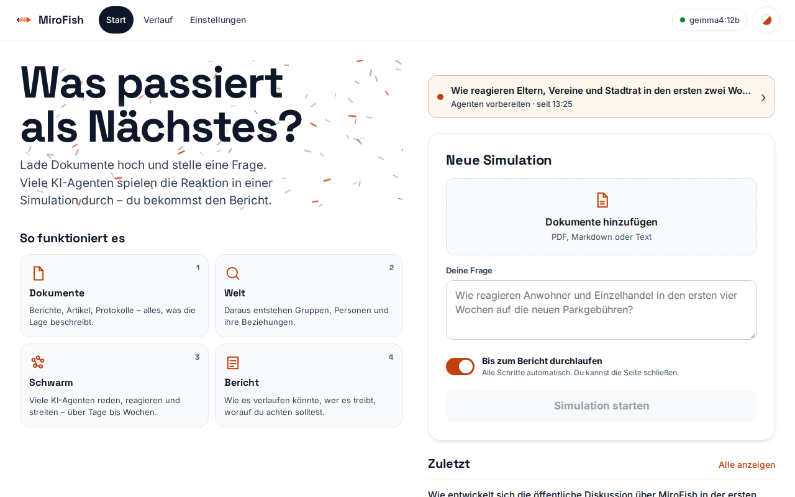
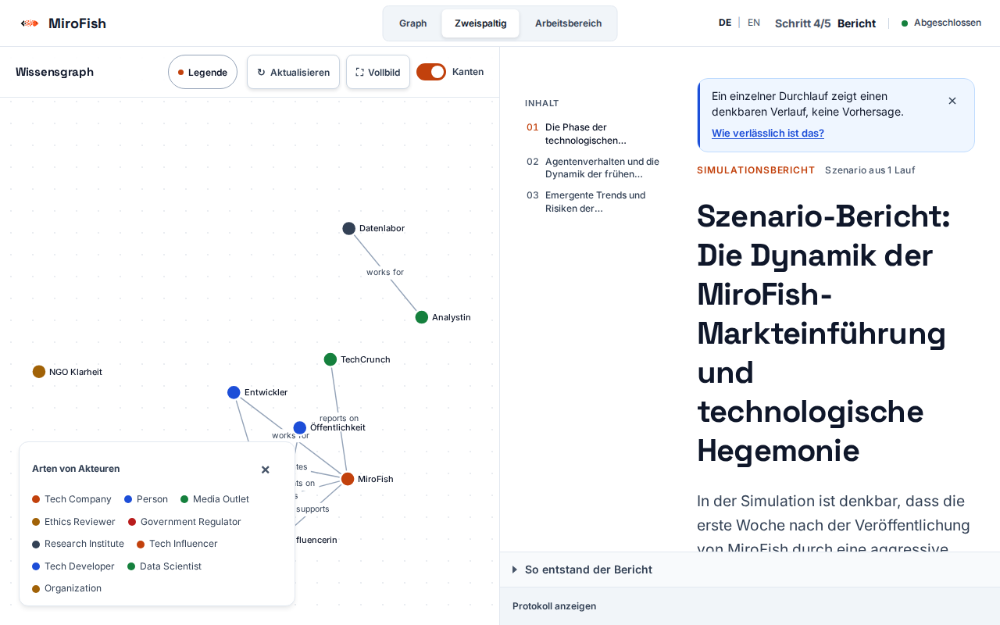

# Anleitung: MiroFish für Gemeinderat, Verein und Bürgerinitiative

*English: [GUIDE.md](GUIDE.md)*

Diese Anleitung ist für Menschen gedacht, die keine Technik-Profis sind: Du sitzt im Gemeinderat, leitest einen Verein oder engagierst dich in einer Bürgerinitiative und willst vor einer Entscheidung durchspielen, wie Menschen reagieren könnten. Du brauchst dafür keine Vorkenntnisse. Die Einrichtung der Software steht in der [README](../README.md); hier geht es um die **Benutzung**.

---

## 1. Wofür sich MiroFish lohnt – und wo die Grenzen liegen

MiroFish lässt viele künstliche Rollen (Agenten) in einem digitalen Netzwerk über dein Thema diskutieren. Du lädst Dokumente hoch, stellst eine Frage und bekommst einen Bericht darüber, wie die Debatte verlaufen *könnte*.

**Dafür lohnt es sich:**

- **Bürgerversammlungen vorbereiten:** Du siehst vorab, welche Fragen und Einwände auf dich zukommen könnten.
- **Argumente und Gegenargumente sammeln,** auch von Gruppen, an die du selbst nicht gedacht hast.
- **Blinde Flecken finden:** Eine Entscheidung oder Ankündigung vorab „durchspielen“ und Schwachstellen entdecken.
- **Kommunikation testen:** Wie kommt ein Text, eine Pressemitteilung oder ein Beschluss bei verschiedenen Gruppen an? Was wird missverstanden?
- **Diskussion im Gremium anstoßen** („Was wäre, wenn …?“).

**Die Grenzen – einmal gebündelt, hier steht alles Wichtige:**

- Ein Bericht ist **keine Prognose** und kein Ersatz für Umfragen, Bürgerbeteiligung oder Gespräche mit echten Menschen. Die Personen und ihre Zitate sind erfunden.
- Zahlen beschreiben nur, wie sich die Simulation verhält, nicht, wie echte Menschen handeln.
- Wer einseitiges Material hineingibt, bekommt es verstärkt zurück. Die Simulation bestätigt also nicht, was du schon glaubst.
- Nutze die Ergebnisse als **Ideengeber und Vorbereitung**, nicht als Beleg.

Die ausführliche Erklärung steht in [VERLAESSLICHKEIT.md](VERLAESSLICHKEIT.md). In der App findest du sie auch unter **Wie verlässlich ist das?**

---

## 2. Gutes Ausgangsmaterial vorbereiten

Die Simulation ist nur so gut wie das, was du hochlädst. Die App liest PDF-, Markdown- und Textdateien.

**Ausgewogen sein.** Nimm sachliche Texte: den Beschlussentwurf, das Sitzungsprotokoll, einen Zeitungsbericht, die Stellungnahme der Verwaltung. Meide polemische Leserbriefe oder Flugblätter als einzige Quelle.

**Mehrere Sichtweisen abbilden.** Ist nur eine Seite im Material vertreten, kommt die Simulation fast zwangsläufig bei dieser Seite an. Lege also auch Argumente der Gegenseite bei: Handel *und* Anwohner, Verwaltung *und* Bürgerinitiative, Befürworter *und* Kritiker.

**Keine vertraulichen Daten.** Lade keine Vorlagen oder Protokolle aus nicht-öffentlichen Sitzungen, keine Namen von Privatpersonen, keine Adresslisten und keine Mitgliederdaten hoch. Prüfe vorher, ob du das Dokument auch öffentlich zeigen würdest. Das ist eine praktische Faustregel und **keine Rechtsberatung**; im Zweifel frag die Verwaltung oder die Datenschutzbeauftragte.

**Lokal oder Cloud – so erkennst du es.** Öffne **Einstellungen**. Dort steht beim Anbieter zum Beispiel **Ollama (auf diesem Rechner)**, **LM Studio (auf diesem Rechner)**, **OpenAI** oder **Anderer OpenAI-kompatibler Server**. Oben auf der Seite siehst du außerdem den Namen des aktuellen Modells. Daneben zeigt ein Schloss **„Lokal – Texte bleiben auf deinen Geräten“**; bei einem Cloud-Anbieter erscheint stattdessen eine Wolke mit **„Cloud: <Anbieter> – Texte werden übertragen“**. Auf dem Handy ist es ein kleines Symbol im Kopf, antippen öffnet die Einstellungen.

- **„… (auf diesem Rechner)“ = lokal:** Deine Texte bleiben auf deinem Rechner.
- **OpenAI = Cloud:** Die Texte werden an den Anbieter gesendet und verlassen deinen Rechner. Auch bei „Anderer OpenAI-kompatibler Server“ prüfe die eingetragene Adresse: Zeigt sie nicht auf deinen eigenen Rechner, ist es ebenfalls Cloud. Dann gilt die Regel „nur öffentliche Texte“ erst recht.

**Kosten.** Lokal fallen keine Gebühren an. Cloud-Anbieter rechnen nach Nutzung ab; je mehr Material und je länger die Simulation, desto mehr kostet es. Die Konditionen legt der Anbieter fest, MiroFish selbst kostet nichts.

**Nicht zu viel, nicht zu wenig.** Ein paar gut gewählte Seiten schlagen einen Aktenberg. Je mehr Material, desto länger dauert alles.

---

## 3. Eine gute Frage formulieren

Auf der Startseite gibst du bei **Deine Frage** an, was du wissen willst. Eine gute Frage hat:

- einen **konkreten Zeitraum** („in den ersten vier Wochen“, „in den ersten 48 Stunden“),
- **beobachtbare Reaktionen** – etwas, das man in Beiträgen lesen könnte (Argumente, Forderungen, Unterschriftensammlung, Beschwerden),
- **bestimmte Gruppen** („Anwohner, Einzelhandel, Pendler“),
- **keine Wertung** in der Formulierung.

| | Beispiel | Warum |
|---|---|---|
| ✅ gut | „Wie reagieren Anwohner und Einzelhandel in den ersten vier Wochen auf die neuen Parkgebühren?“ | Zeitraum, Gruppen und Reaktionen sind klar, die Frage ist neutral. |
| ✅ gut | „Welche Argumente äußern Gewerbetreibende, Pendler und Anwohner in den ersten 48 Stunden nach Veröffentlichung des Beschlusses?“ | Beobachtbar und breit angelegt. |
| ❌ schlecht | „Wann eskaliert der Protest gegen die unverschämten Gebühren?“ | Setzt Eskalation voraus und wertet. |
| ❌ schlecht | „Wird der Verein die Wahl gewinnen?“ | Das ist eine Prognose – dafür ist MiroFish nicht gebaut. |
| ❌ schlecht | „Was denken die Leute?“ | Kein Zeitraum, keine Gruppen, nichts Konkretes. |

---

## 4. Der Ablauf in fünf Schritten

Auf der Startseite klickst du auf **Neue Simulation**, lädst Dokumente hoch, schreibst deine Frage und drückst **Simulation starten**. Bleibt **Bis zum Bericht durchlaufen** eingeschaltet, laufen alle Schritte von allein. Du kannst die Seite schließen; unter **Verlauf** findest du alles wieder. Wer jeden Schritt selbst steuern will, wählt **Schritt für Schritt starten**.

**Rechner und Dauer.** Laut README reicht für die lokale Variante eine Grafikkarte mit 8 GB Speicher; auf einer RTX 3070 dauert ein kurzes Dokument mit einer simulierten Woche gut 30 Minuten. Ob dein Rechner das schafft, erfährst du von deiner IT oder dem Hersteller (Suchbegriff: „Grafikkarte“ bzw. „GPU“ in den Systeminformationen). Bei älteren Geräten oder vielen Unterlagen dauert es länger; belegte Zeiten dafür gibt es nicht. Probiere es mit einem kurzen Dokument aus. Ein Mehrfachlauf (siehe unten) dauert ein Vielfaches.

**Woran du merkst, dass es läuft:** Der Durchlauf zeigt jeden Schritt live auf dem Bildschirm. Auf der Seite **Einstellungen** steht oben, welches Modell bereit ist. Die Berechnung läuft im Hintergrund, du kannst die Seite schließen und später unter **Verlauf** nachsehen. Wie flüssig sich dein Rechner nebenher bedienen lässt, hängt von seiner Leistung ab und lässt sich nicht pauschal zusagen; plane lange Läufe lieber für eine Pause oder den Feierabend.

| Schritt | Name in der App | Was passiert (Alltagssprache) | Dauer (grob) |
|---|---|---|---|
| 1 | **Wissensgraph** (= Themen- und Rollenübersicht) | MiroFish liest deine Dokumente, legt fest, welche Rollen und Beziehungen vorkommen („Rollen und Beziehungen festlegen“) und baut daraus eine Übersicht: Wer ist wer, wer kennt wen? Der Name „Wissensgraph“ ist der Fachbegriff der App für diese Übersicht. | wenige Minuten |
| 2 | **Agenten vorbereiten** | Zu jeder Rolle entsteht eine Person mit Lebenslauf, Haltung und Verhalten. | einige Minuten |
| 3 | **Simulation** | Die Personen schreiben Beiträge auf einem „Nachrichtenplatz“ und in einem „Themenforum“, lesen und antworten einander – über die simulierten Tage. | der längste Teil, oft 15 Minuten bis mehrere Stunden |
| 4 | **Bericht** | Ein Berichts-Agent wertet alle Beiträge aus und schreibt einen Bericht. | einige Minuten |
| 5 | **Nachfragen stellen** | Du kannst dem Bericht und den simulierten Personen Fragen stellen. | beliebig, nach Lust |

---

## 5. Den Bericht lesen

**Ein Einzellauf ist ein denkbarer Verlauf.** Der Bericht beschreibt *eine* Simulation. Sie ist wie eine Theaterprobe mit Improvisation: Ein zweiter Durchgang wäre etwas anders verlaufen. Im Bericht steht deshalb „Szenario aus 1 Lauf“. Schreibe „in der Simulation zeigte sich …“.

**Der Abschnitt „Methodik und Grenzen“.** Im Bericht (siehe auch **So entstand der Bericht**) steht, wie der Bericht zustande kam: Zahl der Läufe, Zahl und Arten der Agenten, simulierte Zeit, Zahl der Beiträge und Kommentare, die verwendeten Sprachmodelle und der Zeitpunkt. Wirf dort immer einen Blick hin. Er zeigt dir auch gleich den wichtigsten Satz: *Ein einzelner Lauf zeigt einen möglichen Verlauf, keine Wahrscheinlichkeit.*

**Der Vorgabe-Abgleich: „Stand schon im Material“.** Manchmal wirkt ein Ergebnis wie eine kluge Voraussicht – dabei stand es schon in deinen Dokumenten. MiroFish vergleicht die Kernaussagen des Berichts mit deinem Ausgangsmaterial. Trifft das zu, steht dort **Stand schon im Material** (mit **Fundstelle anzeigen**). Das ist keine neue Erkenntnis, sondern eine Wiederholung. Im Inhaltsverzeichnis des Berichts heißt der Abschnitt **Vorgabe-Abgleich**.

**Zitate und Namen sind erfunden.** Gib Aussagen nie als echte Zitate weiter.

---

## 6. Wann ein Mehrfachlauf sinnvoll ist

Ein Einzellauf zeigt nur einen Verlauf. Willst du wissen, ob etwas **öfter** vorkommt oder nur ein Zufallstreffer war, nutze den **Mehrfachlauf**: MiroFish wiederholt dieselbe Simulation mehrmals mit neuem Zufall. Das ist sinnvoll,

- wenn du dich auf ein Ergebnis stützen oder es im Gremium vorstellen willst,
- wenn der Einzellauf etwas Auffälliges zeigt (etwa eine Eskalation) und du wissen willst, ob das stabil ist,
- wenn du fragen willst: Entsteht das durch die Gruppendynamik – oder hätte es auch ohne sie so kommen können?

Er kostet aber viel Zeit (ein Vielfaches des Einzellaufs). Für ein erstes Kennenlernen reicht ein Einzellauf.

**So startest du ihn:** Öffne den fertigen Bericht und wähle **Mehrfachlauf starten**. Dort stellst du die **Anzahl Läufe**, die **Dauer je Lauf (Stunden)** und die **Vergleichsvarianten** ein. Unter **Eigene Fragen (optional)** kannst du ein Ereignis in Alltagssprache formulieren, das man in den Beiträgen erkennen kann, zum Beispiel „Es wird zu einer Unterschriftensammlung aufgerufen“. Die **Geschätzte Dauer** wird dir vor dem Start angezeigt.

Die wichtigsten Vergleichsvarianten:

- **Basis (immer dabei):** die volle Simulation mit allen Wechselwirkungen.
- **Ohne Vernetzung:** Die Personen sehen die Beiträge der anderen nicht. Tritt etwas auch hier auf, lag es nicht an der Gruppendynamik.
- **Ein einzelnes Sprachmodell (Nullmodell):** Zum Vergleich schreibt hier ein einziges Sprachmodell in einem Rutsch eine Geschichte, ohne dass viele Rollen miteinander diskutieren (ohne Agenten). Der Unterschied: In der Simulation reagieren viele Rollen aufeinander; im Nullmodell erzählt nur ein Text alles allein. So siehst du, ob der Aufwand der Simulation überhaupt etwas Neues zeigt. „Nullmodell“ ist der Begriff der App für diese Vergleichsbasis.

### Zusammenfassung und Spannen lesen

In den Ergebnissen steht zum Beispiel: **„7 von 10 Läufen · Spanne 39–89 %“**.

- **„7 von 10 Läufen“** heißt: In 7 von 10 Simulationsdurchgängen kam das Ereignis vor.
- **Die Spanne** (Schwankungsbereich) zeigt, wie unsicher diese Zahl bei so wenigen Läufen ist. Eine so breite Spanne wie 39–89 % ist bei 10 Läufen **normal** und kein Fehler: Sie sagt ehrlich, dass man aus so wenigen Durchgängen keine genaue Zahl ablesen kann.
- Deshalb gehören solche Zahlen **nicht in eine Beschlussvorlage**. Nutze stattdessen die **Argumente und Verläufe** aus dem Bericht (siehe Abschnitt 9). Willst du eine Zahl intern nennen, dann nur als „7 von 10 Läufen, Spanne 39–89 %“.
- Es sind keine Wahrscheinlichkeiten für die Wirklichkeit, sondern nur Anteile der Läufe dieser Simulation.
- In der **Hauptfrage** sagt dir ein Satz, ob sich Simulation und Vergleichsvarianten unterscheiden. Steht dort „kein klarer Unterschied“, hat die Gruppendynamik nichts Besonderes beigetragen.
- **„nicht messbar“** oder **„Auswerter uneinig – Zahl nicht deuten“** bedeutet: Die beiden automatischen Prüfungen kamen zu unterschiedlichen Urteilen. Lies die Zahl dann nicht als Ergebnis.
- **„Stand schon im Material“** gilt auch hier: Das Ergebnis kam schon aus deinen Dokumenten.
- **Zusatzbeobachtungen (explorativ)** sind nur Hinweise, **nicht als Beleg verwenden**.

---

## 7. Nachfragen stellen

Im fünften Schritt, **Nachfragen stellen**, kannst du im Gespräch tiefer gehen:

- **Chat mit dem Berichts-Agenten:** Er beantwortet Fragen zum Bericht („Warum haben die Anwohner so reagiert?“) und recherchiert dafür in den Daten.
- **Mit einer beliebigen Person der Welt chatten:** Wähle eine simulierte Person und frage nach ihrer Haltung. Das ist ein Rollenspiel mit einer erfundenen Figur, hilfreich, um Blickwinkel zu verstehen.
- **Umfrage an simulierte Personen senden:** Du schickst dieselbe Frage an mehrere erfundene Rollen auf einmal und siehst die Antworten nebeneinander. Das ist keine echte Umfrage.

**Simulierte Rollen, keine Bürgerbeteiligung:** Die Antworten kommen vom Computer, nicht von Bürgerinnen und Bürgern. Gib sie nie als „so denken die Bürger“ weiter. Echte Beteiligung bleibt nötig.

---

## 8. Ergebnisse weitergeben: die Checkliste

Bevor du etwas an Gremium, Mitglieder, Presse oder Öffentlichkeit weitergibst:

- [ ] **Neutrale Vorlage:** War dein Ausgangsmaterial sachlich und enthielt verschiedene Perspektiven?
- [ ] **Laufart benannt:** Machst du klar, ob es ein einzelnes Szenario (Einzellauf) oder Häufigkeiten (Mehrfachlauf) sind?
- [ ] **Keine Prognose-Sprache:** Schreibst du „mögliches Szenario in einer Simulation“ statt „Vorhersage für die Realität“?
- [ ] **Vorgaben geprüft:** Hast du beachtet, was schon wörtlich in deinem Material stand („Stand schon im Material“)?
- [ ] **Schwankungsbreite genannt:** Gibst du bei Mehrfachläufen die Spanne an (z. B. „7 von 10 Läufen, Spanne 39–89 %“) statt einer Einzelzahl?

Hilfreich zusätzlich: Nenne die Frage, das Material und das Datum.

---

## 9. So bringst du Ergebnisse seriös ein

Zitiere keine Zahlen und keine „Aussagen“ der simulierten Personen. Nimm stattdessen die **Argumente und Verläufe**, die du für nachvollziehbar hältst, und mache die Herkunft transparent. Ein Mustertext für eine Beschlussvorlage oder Sitzungsunterlage:

> „Zur Vorbereitung der Bürgerinformation wurde mit einer KI-gestützten Simulation (MiroFish, ein Durchlauf, [Datum]) auf Grundlage der öffentlich zugänglichen Unterlagen [Titel] durchgespielt, welche Einwände und Fragen auftreten könnten. Die Simulation arbeitet mit erfundenen Rollen und ist weder eine Prognose noch eine Bürgerbefragung. Sie hat unter anderem folgende Punkte aufgeworfen, die wir in der Information berücksichtigen: [Argument 1], [Argument 2]. Ob diese Punkte tatsächlich eine Rolle spielen, ist durch die Beteiligung der Bürgerinnen und Bürger zu klären.“

Das schützt dich vor dem Eindruck, die Simulation „belege“ etwas: Du nutzt sie als Denkanstoß und sagst das offen.

---

## 10. Alte Läufe wiederfinden und aufräumen

Unter **Verlauf** siehst du alle bisherigen Simulationen mit Bericht und **Export** (alles als ZIP). Mit **Löschen** entfernst du eine Simulation samt Bericht und Daten dauerhaft. Das ist wichtig, wenn du sicher gehen willst, dass nichts liegen bleibt.

